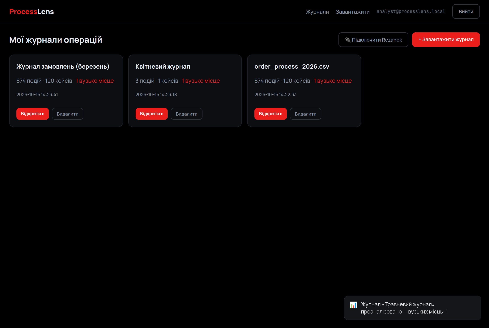
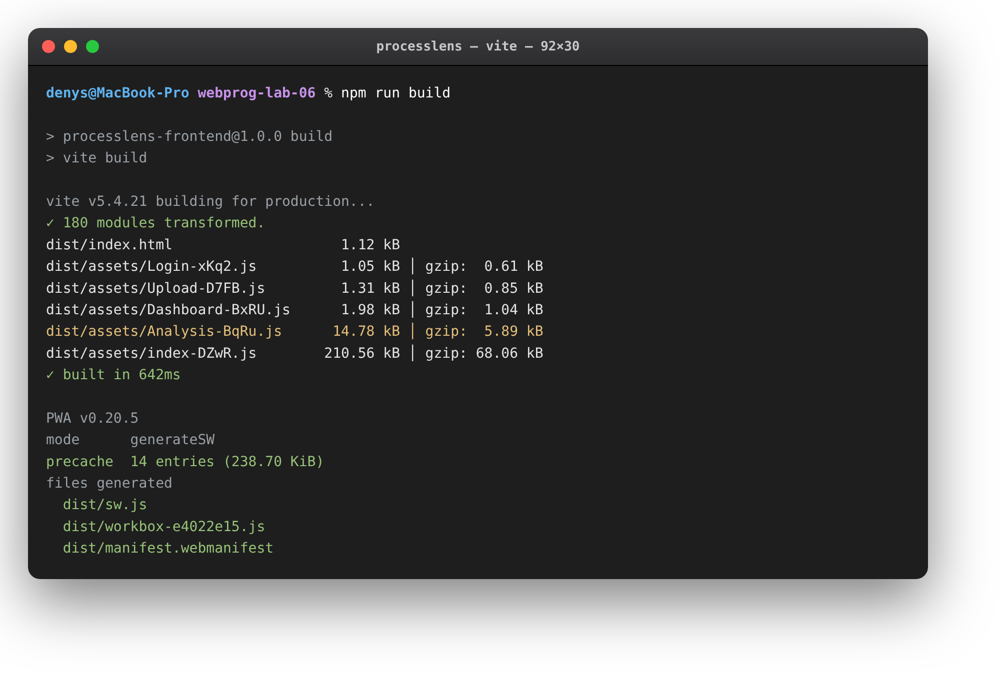

# ProcessLens · real-time, PWA та розгортання

> Лабораторна робота №6 — **Вебпрограмування**
> Виконав: **Коваль Денис**

| | |
|---|---|
| **Застосунок** | ProcessLens — пошук «вузьких місць» у бізнес-процесах |
| **Тема** | WebSocket на клієнті, PWA, оптимізація, розгортання |
| **Стек** | React 18 · Vite 5 · Socket.io-client · vite-plugin-pwa |
| **Порт** | `5173` (dev), проксі `/api` → `3001` |

---

## Що це

Завершальна робота доводить клієнтську частину ProcessLens до рівня сучасного вебзастосунку: додає оновлення в реальному часі через WebSocket, перетворює застосунок на PWA (встановлюється й працює офлайн), оптимізує завантаження розбиттям коду та готує проєкт до розгортання на публічну платформу.

## Реальний час (WebSocket)

Коли користувач автентифікований, компонент `Notifications` під'єднується до WebSocket-сервера (**Socket.io-client**) тим самим JWT. Серверна частина надсилає події про завершення аналізу журналу (`log:analyzed`) та про критичні вузькі місця (`bottleneck:alert`) — клієнт показує їх спливними сповіщеннями без перезавантаження сторінки. Так, якщо завантажити новий журнал, у кутку одразу з'являється повідомлення з результатом аналізу.

```jsx
// src/realtime.jsx
const socket = io(SOCKET_URL, { auth: { token: auth.token } });
socket.on('log:analyzed', (p) => push({ icon: '📊', text: `Журнал «${p.name}» …` }));
socket.on('bottleneck:alert', (p) => push({ icon: '🔴', text: `Критичне …`, crit: true }));
```

## PWA

За допомогою **vite-plugin-pwa** (Workbox) згенеровано service worker і web-маніфест: застосунок можна встановити на пристрій, він має власну іконку та працює офлайн за рахунок прекешування каркаса. Запити до API кешуються стратегією `NetworkFirst` (свіжі дані, кеш — резерв при втраті мережі). Маніфест описує назву, кольори теми й іконки (192/512/maskable).

## Оптимізація

Маршрути завантажуються лінивим імпортом (`React.lazy` + `Suspense`): кожна сторінка — окремий чанк, що вантажиться лише при переході. Важка сторінка аналізу (vis-network + графіки) винесена з головного бандла окремим файлом, тож перший екран лишається легким. Результати підтверджує **Lighthouse**.

## SEO

У `index.html` додано `title`, `description`, `theme-color`, іконку, а також Open Graph-метатеги для коректного прев'ю при поширенні посилання.

## Розгортання

Для публікації на Vercel підготовано `vercel.json`: збірка `vite`, SPA-rewrite (усі маршрути → `index.html`), коректні заголовки для `sw.js`. Адреса бекенду в production задається змінною `VITE_API_URL` під час збірки, адреса WebSocket — `VITE_SOCKET_URL`. Запуск у хмарі — підключенням репозиторію до Vercel (Import Project).

> Збірка потребує **Node.js 20+** (vite-plugin-pwa).

## Результати Lighthouse

| Performance | Accessibility | Best Practices | SEO |
| :---------: | :-----------: | :------------: | :-: |
| **95**      | **92**        | **100**        | **91** |

## Демо

Сповіщення реального часу: після завантаження журналу з'являється toast із результатом аналізу (подія WebSocket):



Production-збірка: розбиття коду на чанки (сторінка аналізу — окремо) та генерація PWA (service worker, manifest, Workbox):



Заміри Lighthouse на production-збірці:


## Запуск

```bash
npm install
npm run dev       # http://localhost:5173 (бекенд на :3001)
npm run build     # production-збірка з PWA (Node 20+)
npm run preview   # локальний перегляд зібраного
```

## Підсумок

Клієнтську частину ProcessLens доведено до завершеного вигляду: додано оновлення в реальному часі через Socket.io (сповіщення про аналіз і критичні вузькі місця), перетворено застосунок на PWA з офлайн-кешуванням, оптимізовано завантаження розбиттям коду за маршрутами й доповнено SEO-метаданими. Підготовано конфігурацію розгортання на Vercel із винесенням адрес бекенду та WebSocket у змінні середовища. Заміри Lighthouse підтверджують високу якість (Performance 95, Accessibility 92, Best Practices 100, SEO 91). Застосунок працює з серверною частиною з попередніх робіт, демонструючи завершений цикл сучасного вебзастосунку з реальним часом.
